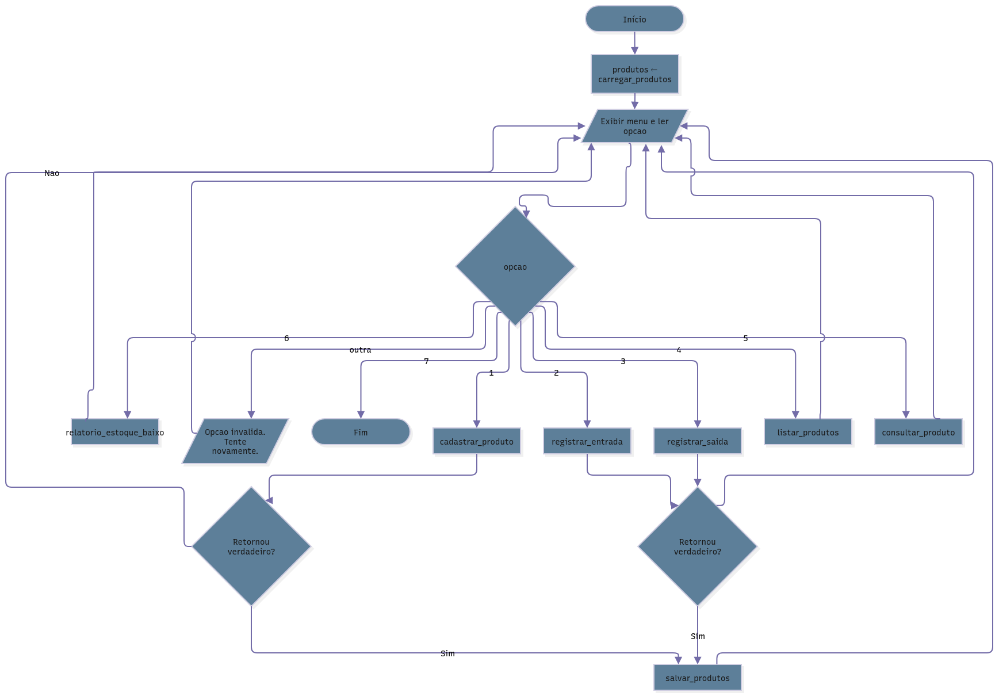
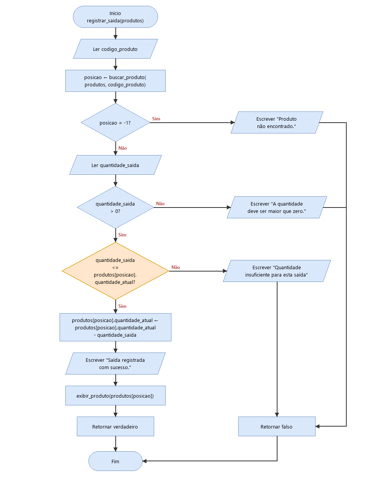

<div class="capa">

<p class="logo"></p>

<p class="inst">UNIVERSIDADE SALVADOR – UNIFACS</p>

<p class="curso">Algoritmo e Programação 2026.2</p>

<p class="titulo">SISTEMA DE CONTROLE DE ESTOQUE</p>

<p class="autores">Eduardo Santos do Nascimento — RA 12724145221<br />
Agnaldo Cândido de Almeida Júnior — RA 12723213093<br />
Patrick Silva — RA 1272627630</p>

<p class="local">Salvador<br />
2026</p>

</div>

<div class="resumo">

<h2 class="pre">RESUMO</h2>

Este trabalho descreve o desenvolvimento de um sistema de controle de estoque em Python, executado em terminal, para o cadastro de produtos e o registro de movimentações. O problema tratado é o controle manual, sujeito a divergências entre a quantidade registrada e a disponível. A solução foi planejada em etapas de definição, modelagem e algoritmo, e implementada com orientação a objetos, validação de dados e persistência em arquivo CSV. O programa permite cadastrar, remover, listar e consultar produtos, registrar entradas e saídas, bloquear saídas maiores que o saldo e emitir relatório de estoque baixo. Os testes realizados cobriram cenários normais, alternativos e excepcionais e confirmaram que as operações inválidas não alteram os dados nem regravam o arquivo. Conclui-se que os objetivos propostos foram alcançados no escopo da disciplina, com limitações conhecidas e melhorias indicadas para trabalhos futuros.

**Palavras-chave:** controle de estoque; algoritmos; programação em Python; persistência em arquivo.

</div>

## 1 Introdução

O projeto apresenta um **Sistema de Controle de Estoque** para empresas que compram, armazenam e vendem produtos. A área de aplicação é a gestão de estoque de pequenos e médios negócios (varejo de periféricos de informática e material escolar, por exemplo), em que o controle ainda costuma ser feito por anotações ou planilhas não integradas.

A solução é um programa em Python, executado em terminal, que cadastra produtos, registra entradas e saídas, consulta itens e emite um relatório de produtos com estoque baixo. Os dados ficam gravados em um arquivo CSV e permanecem disponíveis após o encerramento do programa.

## 2 Descrição do problema

**Cenário:** o controle manual de estoque gera divergência entre a quantidade registrada e a real, perda de produtos, dificuldade de identificar itens em falta e demora na atualização das informações.

**Usuários:** o responsável pelo estoque (operador), que cadastra produtos e lança as movimentações.

**Necessidades:** cadastrar e localizar produtos, atualizar a quantidade a cada movimentação, impedir saídas maiores que o saldo e saber quais itens precisam de reposição.

**Entradas disponíveis:** código, nome, categoria, quantidade inicial, quantidade mínima, quantidade de entrada e quantidade de saída.

**Resultados esperados:** lista de produtos com a quantidade disponível, confirmação das movimentações, aviso de saldo insuficiente e indicação dos produtos abaixo do mínimo.

## 3 Justificativa

Um controle informatizado torna o gerenciamento mais rápido, seguro e rastreável. Os benefícios esperados são:

- redução de erros de registro e de dependência de controles manuais;
- prevenção de ruptura de estoque, pelo alerta de reposição;
- garantia de consistência, pois o programa impede estoque negativo;
- persistência das informações entre as execuções.

Do ponto de vista acadêmico, o problema é adequado para aplicar variáveis, estruturas condicionais e de repetição, vetores/coleções, modularização, arquivos, tratamento de erros e POO.

## 4 Objetivos

**Objetivo geral:** desenvolver um sistema computacional para controle de estoque, permitindo cadastro, consulta e atualização das quantidades por meio de entradas e saídas.

**Objetivos específicos:**

- cadastrar produtos e armazenar suas informações básicas;
- consultar os produtos cadastrados (por código ou nome);
- registrar entradas e saídas e atualizar automaticamente a quantidade;
- impedir saídas superiores à quantidade existente;
- identificar e exibir produtos com estoque baixo;
- persistir os dados em arquivo CSV.

## 5 Requisitos e regras da solução

### 5.1 Requisitos funcionais

<p class="legenda">Tabela 1 – Requisitos funcionais do sistema</p>

| Código | Requisito |
|---|---|
| RF01 | Cadastrar produto (código, nome, categoria, quantidade inicial e mínima). |
| RF02 | Remover produto, com confirmação do usuário. |
| RF03 | Registrar entrada de unidades. |
| RF04 | Registrar saída de unidades. |
| RF05 | Listar todos os produtos. |
| RF06 | Consultar produto por código ou por nome. |
| RF07 | Emitir relatório de estoque baixo. |
| RF08 | Carregar os dados do CSV ao iniciar e gravar após cada alteração. |

<p class="fonte">Fonte: elaborada pelos autores.</p>

### 5.2 Regras de negócio

- **Entrada:** `quantidade_atual = quantidade_atual + quantidade_entrada`.
- **Saída:** `quantidade_atual = quantidade_atual - quantidade_saida`, permitida somente se `quantidade_saida <= quantidade_atual`; caso contrário, exibe "Quantidade insuficiente para esta saída".
- **Alerta:** se `quantidade_atual < quantidade_minima`, o produto recebe o status "Estoque Baixo / Necessidade de Reposição".

### 5.3 Restrições

- `codigo_produto` é inteiro, positivo e único.
- Nome e categoria são obrigatórios e não podem conter `;` (separador do CSV).
- Quantidade inicial e mínima são inteiras e >= 0; entrada e saída são inteiras e > 0.
- Não existe estoque negativo.
- Limite de 100 produtos (`MAX_PRODUTOS`).
- Operação inválida não altera os dados nem regrava o CSV.

## 6 Decomposição do problema

O problema principal (controlar o estoque) foi dividido em módulos menores, definidos na Entrega 2 e distribuídos na Entrega 3:

<p class="legenda">Tabela 2 – Divisão do problema em módulos</p>

| Módulo | Tarefas | Implementação |
|---|---|---|
| Programa principal | Menu, laço de repetição e chamada dos módulos. | `src/main.py` |
| Módulo 1 – Cadastro | Ler dados, validar restrições, inserir e remover produtos. | `Estoque.cadastrar_produto`, `Estoque.remover_produto` |
| Módulo 2 – Movimentações | Buscar produto, validar quantidade, aplicar entrada ou saída. | `buscar_produto`, `Estoque.registrar_entrada`, `Estoque.registrar_saida` |
| Módulo 3 – Consultas | Listar, consultar e exibir produtos. | `listar_produtos`, `consultar_produto`, `exibir_produto` |
| Módulo 4 – Relatórios | Varrer a lista e filtrar estoque baixo. | `relatorio_estoque_baixo` |
| Módulo 5 – Persistência | Ler e gravar o CSV. | `ArmazenamentoCSV` |

<p class="fonte">Fonte: elaborada pelos autores.</p>

## 7 Modelagem da solução

**Entradas → Dados/Variáveis → Regras/Condições → Processamento → Saídas**

<p class="legenda">Tabela 3 – Modelagem: entradas, dados, regras, processamento e saídas</p>

| Etapa | Descrição |
|---|---|
| **Entradas** | Opção do menu; código, nome, categoria; quantidade inicial e mínima; quantidade de entrada e de saída; critério de busca. |
| **Dados/Variáveis** | `codigo_produto` (inteiro, chave primária), `nome_produto` (texto), `categoria_produto` (texto), `quantidade_atual` (inteiro), `quantidade_minima` (inteiro). |
| **Regras/Condições** | Código único; campos obrigatórios; valores >= 0; saída <= saldo; alerta se atual < mínima. |
| **Processamento** | Carregar CSV, validar, buscar, somar/subtrair quantidades, comparar com o mínimo, gravar CSV. |
| **Saídas** | Mensagens de confirmação ou erro, dados do produto com status, lista completa, relatório de estoque baixo, CSV atualizado. |

<p class="fonte">Fonte: elaborada pelos autores.</p>

**Relações:** a entidade `Produto` é identificada por `codigo_produto`; a coleção de produtos é a base de todas as operações.

## 8 Algoritmo proposto

### 8.1 Estratégia

O programa carrega os produtos do CSV, apresenta um menu em laço e executa a operação escolhida. Operações que alteram dados só gravam o CSV quando bem-sucedidas, e toda entrada é validada antes de modificar o estoque.

### 8.2 Pseudocódigo

**Programa principal**

```
ALGORITMO ControleEstoque
VAR opcao: caractere
INICIO
  carregar_produtos()
  REPITA
    exibir menu
    LEIA opcao
    ESCOLHA opcao
      "1": cadastrar_produto()
      "2": remover_produto()
      "3": registrar_entrada()
      "4": registrar_saida()
      "5": listar_produtos(produtos)
      "6": consultar_produto(produtos)
      "7": relatorio_estoque_baixo(produtos)
      "0": ESCREVA "Encerrando o sistema..."
      OUTRO: ESCREVA "Opção inválida. Tente novamente."
    FIMESCOLHA
  ATE opcao = "0"
FIM
```

**Busca sequencial**

```
FUNCAO buscar_produto(produtos, codigo): inteiro
  PARA i DE 1 ATE tamanho(produtos) FACA
    SE produtos[i].codigo_produto = codigo ENTAO
      RETORNE i
    FIMSE
  FIMPARA
  RETORNE -1
FIMFUNCAO
```

**Cadastro**

```
FUNCAO cadastrar_produto(produtos): logico
  SE tamanho(produtos) >= 100 ENTAO ESCREVA "Limite de produtos atingido"; RETORNE falso
  LEIA codigo_produto
  SE codigo_produto invalido OU codigo_produto <= 0 ENTAO ESCREVA "Código inválido"; RETORNE falso
  SE buscar_produto(produtos, codigo_produto) <> -1 ENTAO ESCREVA "Produto já cadastrado"; RETORNE falso
  LEIA nome_produto, categoria_produto
  SE nome vazio OU categoria vazia OU contem ";" ENTAO ESCREVA "... inválido(a)"; RETORNE falso
  LEIA quantidade_atual, quantidade_minima
  SE nao inteiros OU algum < 0 ENTAO ESCREVA "Quantidade inválida"; RETORNE falso
  inserir novo Produto em produtos
  salvar_produtos(produtos)
  ESCREVA "Produto cadastrado com sucesso"
  RETORNE verdadeiro
FIMFUNCAO
```

> **Nota de implementação:** a verificação de duplicidade no cadastro usa `ArmazenamentoCSV.buscar` (dicionário, O(1)); o pseudocódigo acima segue o contrato da Entrega 3, modelado sobre o vetor. `buscar_produto` continua atendendo às movimentações e consultas.

**Entrada e saída**

```
FUNCAO registrar_entrada(produtos): logico
  LEIA codigo_produto
  pos <- buscar_produto(produtos, codigo_produto)
  SE pos = -1 ENTAO ESCREVA "Produto não encontrado"; RETORNE falso
  LEIA quantidade_entrada
  SE invalida OU quantidade_entrada <= 0 ENTAO ESCREVA "Quantidade inválida"; RETORNE falso
  produtos[pos].quantidade_atual <- produtos[pos].quantidade_atual + quantidade_entrada
  salvar_produtos(produtos)
  ESCREVA "Entrada registrada com sucesso"
  exibir_produto(produtos[pos])
  RETORNE verdadeiro
FIMFUNCAO

FUNCAO registrar_saida(produtos): logico
  LEIA codigo_produto
  pos <- buscar_produto(produtos, codigo_produto)
  SE pos = -1 ENTAO ESCREVA "Produto não encontrado"; RETORNE falso
  LEIA quantidade_saida
  SE invalida OU quantidade_saida <= 0 ENTAO ESCREVA "Quantidade inválida"; RETORNE falso
  SE quantidade_saida > produtos[pos].quantidade_atual ENTAO
    ESCREVA "Quantidade insuficiente para esta saída"
    RETORNE falso
  FIMSE
  produtos[pos].quantidade_atual <- produtos[pos].quantidade_atual - quantidade_saida
  salvar_produtos(produtos)
  ESCREVA "Saída registrada com sucesso"
  exibir_produto(produtos[pos])
  RETORNE verdadeiro
FIMFUNCAO
```

**Consultas e relatório**

```
PROCEDIMENTO exibir_produto(produto)
  ESCREVA código, nome, categoria, quantidade_atual, quantidade_minima
  SE produto.quantidade_atual < produto.quantidade_minima ENTAO
    ESCREVA "Status: Estoque Baixo / Necessidade de Reposição"
  SENAO
    ESCREVA "Status: OK"
  FIMSE
FIMPROCEDIMENTO

PROCEDIMENTO relatorio_estoque_baixo(produtos)
  total_baixo <- 0
  PARA cada produto EM produtos FACA
    SE produto.quantidade_atual < produto.quantidade_minima ENTAO
      exibir_produto(produto)
      total_baixo <- total_baixo + 1
    FIMSE
  FIMPARA
  SE total_baixo = 0 ENTAO ESCREVA "Nenhum produto com estoque baixo."
FIMPROCEDIMENTO
```

### 8.3 Estruturas do algoritmo

- **Sequenciais:** leitura de dados, cálculo da nova quantidade, gravação.
- **Condicionais:** validações, decisão `quantidade_saida <= quantidade_atual`, alerta de estoque baixo, escolha do menu (`match`).
- **Repetição:** laço do menu, busca sequencial, listagem e relatório (`for`), leitura de cada linha do CSV.

### 8.4 Fluxogramas

Os fluxogramas estão em `entregas/entrega-3/`:

- Geral do sistema: `fluxograma.png`
- Consulta de produto: `fluxograma-consulta.png`
- Entrada de produtos: `fluxograma-entrada.png`
- Saída de produtos: `fluxograma-saida.png`
- Relatório de estoque baixo: `fluxograma-estoque-baixo.png`

<p class="legenda">Figura 1 – Fluxograma geral do sistema</p>



<p class="fonte">Fonte: elaborada pelos autores.</p>

<p class="legenda">Figura 2 – Fluxograma da saída de produtos</p>



<p class="fonte">Fonte: elaborada pelos autores.</p>

## 9 Estruturas de dados utilizadas

<p class="legenda">Tabela 4 – Estruturas de dados utilizadas</p>

| Estrutura | Uso | Motivo da escolha |
|---|---|---|
| Variáveis simples (`int`, `str`) | Entradas do usuário e campos do produto. | Representam diretamente cada dado. |
| Registro (`Produto`, `dataclass`) | Agrupa os cinco campos de um produto. | Mantém os dados relacionados juntos e evita vetores paralelos. |
| Dicionário (`dict`, código → `Produto`) | Coleção interna de `ArmazenamentoCSV`. | Busca por código em tempo constante e garantia de unicidade da chave. |
| Lista (`list`) | Vetor `produtos` entregue às funções de consulta e movimentação. | Permite percorrer sequencialmente (busca, listagem, relatório), como no pseudocódigo. |
| Arquivo CSV | Armazenamento permanente. | Simples, legível e suficiente para o volume do projeto. |

<p class="fonte">Fonte: elaborada pelos autores.</p>

## 10 Organização do programa e POO

```
src/
├── main.py          # menu e laço principal
├── produto.py       # classe Produto
├── armazenamento.py # classe ArmazenamentoCSV
├── estoque.py       # classe Estoque + buscar_produto
└── consultas.py     # exibir/listar/consultar/relatório
dados/produtos.csv   # base de dados
```

**Classes → Objetos → Atributos → Métodos → Relacionamentos**

<p class="legenda">Tabela 5 – Classes, atributos e métodos</p>

| Classe | Objetos | Atributos | Métodos principais |
|---|---|---|---|
| `Produto` | Um por item do estoque. | `codigo_produto`, `nome_produto`, `categoria_produto`, `quantidade_atual`, `quantidade_minima` | (dataclass) |
| `ArmazenamentoCSV` | Um por execução. | `caminho`, `__produtos` (privado) | `carregar`, `salvar`, `buscar`, `adicionar`, `remover`, propriedade `produtos` |
| `Estoque` | Um por execução. | `__armazenamento` (privado) | `carregar_produtos`, `cadastrar_produto`, `remover_produto`, `registrar_entrada`, `registrar_saida`, propriedade `produtos` |

<p class="fonte">Fonte: elaborada pelos autores.</p>

**Relacionamentos:** `Estoque` **usa** (composição) um `ArmazenamentoCSV`, que **contém** vários objetos `Produto`. As funções de `consultas.py` recebem a lista de `Produto`.

**Conceitos de POO aplicados:**

- **Encapsulamento:** os atributos `__produtos` e `__armazenamento` são privados; o acesso é feito por métodos e pela propriedade `produtos`.
- **Abstração:** `Estoque` esconde os detalhes de persistência, que ficam em `ArmazenamentoCSV`.
- **Herança e polimorfismo:** não utilizados, pois o domínio é simples e não possui hierarquia de tipos.

## 11 Tecnologias utilizadas

<p class="legenda">Tabela 6 – Tecnologias utilizadas</p>

| Tecnologia | Finalidade |
|---|---|
| Python 3 (usa `match`, portanto 3.10+) | Linguagem de implementação. |
| Módulo `csv` | Leitura e escrita do arquivo de dados. |
| Módulo `pathlib` | Manipulação portável do caminho do arquivo. |
| Módulo `dataclasses` | Definição da classe `Produto`. |
| Arquivo CSV | Persistência dos dados. |
| draw.io | Criação dos fluxogramas. |
| Git e GitHub | Controle de versão e trabalho colaborativo. |
| Markdown | Documentação das entregas. |

<p class="fonte">Fonte: elaborada pelos autores.</p>

Não foram utilizados SGBD nem bibliotecas externas.

## 12 Implementação

O pseudocódigo foi traduzido quase diretamente para métodos e funções Python.

**Busca sequencial** (`src/estoque.py`):

```python
def buscar_produto(produtos, codigo):
    for i in range(len(produtos)):
        if produtos[i].codigo_produto == codigo:
            return i
    return -1
```

**Regra de saída** (`Estoque.registrar_saida`):

```python
if quantidade_saida > produto.quantidade_atual:
    print("Quantidade insuficiente para esta saída")
    return False

produto.quantidade_atual -= quantidade_saida
self.__armazenamento.salvar()
```

**Alerta de estoque baixo** (`src/consultas.py`):

```python
if produto.quantidade_atual < produto.quantidade_minima:
    print("Status: Estoque Baixo / Necessidade de Reposição")
else:
    print("Status: OK")
```

**Menu principal** (`src/main.py`): laço `while True` com `match opcao`, que chama o método correspondente a cada opção e encerra com `break` na opção `0`.

Para executar: `python3 src/main.py`.

## 13 Persistência e armazenamento de dados

Os dados são armazenados em `dados/produtos.csv`, com separador `;`, codificação UTF-8, cabeçalho e uma linha por produto:

```
codigo_produto;nome_produto;categoria_produto;quantidade_atual;quantidade_minima
101;Teclado Mecânico;Periféricos;12;5
102;Mouse USB;Periféricos;3;10
```

- **Recuperação:** `ArmazenamentoCSV.carregar()` lê o arquivo com `csv.DictReader` no início do programa. Se o arquivo não existir, o sistema inicia com a lista vazia.
- **Gravação:** `ArmazenamentoCSV.salvar()` sobrescreve o arquivo inteiro após cada cadastro, remoção, entrada ou saída bem-sucedidos.
- **Durante a execução**, os produtos ficam em memória (dicionário/lista), e o CSV é a cópia permanente.

Não há banco de dados, SGBD, tabelas nem operações SQL. O CSV foi escolhido pela simplicidade e pelo volume reduzido de dados.

## 14 Tratamento de erros e exceções

<p class="legenda">Tabela 7 – Tratamento de erros e exceções</p>

| Situação | Tratamento |
|---|---|
| Código ou quantidade não numéricos | `try/except (ValueError, EOFError)` nas leituras numéricas (na consulta por código, apenas `ValueError`), com "Código inválido" / "Quantidade inválida". |
| Código <= 0 | "Código inválido". |
| Quantidade negativa no cadastro; entrada/saída <= 0 | "Quantidade inválida", sem alterar dados. |
| Código repetido | "Produto já cadastrado". |
| Nome ou categoria vazios, ou com `;` | "Nome do produto inválido" / "Categoria do produto inválida". |
| Produto inexistente | "Produto não encontrado". |
| Saída maior que o saldo | "Quantidade insuficiente para esta saída". |
| Limite de 100 produtos | "Limite de produtos atingido". |
| Opção de menu inválida | "Opção inválida. Tente novamente." |
| Remoção não confirmada | "Operação cancelada". |
| Arquivo CSV inexistente | Início com estoque vazio. |
| Código duplicado dentro do CSV | `ValueError` com a mensagem "Código duplicado no CSV". |

<p class="fonte">Fonte: elaborada pelos autores.</p>

Em todos os casos, a operação inválida não altera o estoque nem regrava o arquivo.

## 15 Testes realizados

Os testes foram executados no programa (`python3 src/main.py`) sobre uma cópia do `dados/produtos.csv` com os produtos 101 a 106, com as entradas passadas em sequência pela entrada padrão. As saídas abaixo foram capturadas dessas execuções.

<p class="legenda">Tabela 8 – Testes realizados</p>

| Teste | Cenário | Entrada | Resultado esperado | Resultado obtido | Situação |
|---|---|---|---|---|---|
| 1 | **Normal:** cadastro válido | Opção 1; código 201, "Monitor", "Monitores", inicial 8, mínima 3 | "Produto cadastrado com sucesso" e gravação no CSV | Mensagem exibida; linha `201;Monitor;Monitores;8;3` gravada | Aprovado |
| 2 | **Normal:** entrada | Opção 3; produto 101; quantidade 10 | Quantidade passa de 12 para 22 | "Entrada registrada com sucesso", quantidade 22 | Aprovado |
| 3 | **Normal:** saída com saldo | Opção 4; produto 101; quantidade 5 | Quantidade passa de 22 para 17 | "Saída registrada com sucesso", quantidade 17 | Aprovado |
| 4 | **Alternativo:** consulta por nome | Opção 6; tipo 2; "Mouse USB" | Exibe o produto com alerta de estoque baixo | Produto 102 exibido com "Estoque Baixo / Necessidade de Reposição" | Aprovado |
| 5 | **Alternativo:** relatório de estoque baixo | Opção 7 | Lista apenas os produtos 102 e 104 | Somente 102 e 104 listados | Aprovado |
| 6 | **Alternativo:** listagem e persistência | Opção 5 após as operações anteriores | Lista com quantidades atualizadas, que coincidem com o CSV | 101 com 17 e 201 incluído; CSV idêntico | Aprovado |
| 7 | **Excepcional:** saída maior que o saldo | Opção 4; produto 102 (saldo 3); quantidade 50 | Bloqueio com aviso e saldo mantido | "Quantidade insuficiente para esta saída"; saldo 3 | Aprovado |
| 8 | **Excepcional:** quantidade não numérica | Opção 4; produto 102; "abc" | "Quantidade inválida" | "Quantidade inválida" | Aprovado |
| 9 | **Excepcional:** entrada negativa | Opção 3; produto 101; -2 | "Quantidade inválida" | "Quantidade inválida" | Aprovado |
| 10 | **Excepcional:** código repetido | Opção 1; código 101 | "Produto já cadastrado" | "Produto já cadastrado" | Aprovado |
| 11 | **Excepcional:** nome vazio | Opção 1; código 202; nome vazio | "Nome do produto inválido" | "Nome do produto inválido" | Aprovado |
| 12 | **Excepcional:** produto inexistente | Opção 6; tipo 1; código 999 | "Produto não encontrado" | "Produto não encontrado" | Aprovado |

<p class="fonte">Fonte: elaborada pelos autores.</p>

## 16 Resultados e análise

**Saída do programa (entrada e saída de produto):**

```
Código do produto: Quantidade de entrada: Entrada registrada com sucesso
Código: 101
Nome: Teclado Mecânico
Categoria: Periféricos
Quantidade atual: 22
Quantidade mínima: 5
Status: OK
------------------------------
```

**Relatório de estoque baixo:**

```
===== RELATÓRIO DE ESTOQUE BAIXO =====
Código: 102
Nome: Mouse USB
Categoria: Periféricos
Quantidade atual: 3
Quantidade mínima: 10
Status: Estoque Baixo / Necessidade de Reposição
------------------------------
Código: 104
Nome: Caneta Azul
Categoria: Material Escolar
Quantidade atual: 0
Quantidade mínima: 15
Status: Estoque Baixo / Necessidade de Reposição
------------------------------
```

**Arquivo CSV após os testes 1 a 3:**

```
codigo_produto;nome_produto;categoria_produto;quantidade_atual;quantidade_minima
101;Teclado Mecânico;Periféricos;17;5
...
201;Monitor;Monitores;8;3
```

**Análise:** os 12 testes apresentaram o resultado esperado. O estoque nunca ficou negativo, as entradas e saídas atualizaram corretamente as quantidades, o alerta identificou os produtos abaixo do mínimo e os dados foram mantidos no CSV. Assim, o problema inicial (controle de produtos e movimentações com prevenção de inconsistências) foi resolvido no escopo proposto.

## 17 Limitações

- Interface apenas em terminal, sem interface gráfica.
- Sem histórico das movimentações: só a quantidade atual é guardada, sem data, usuário ou tipo.
- Sem controle de acesso ou de usuários.
- A consulta por nome exige o nome exato (diferencia maiúsculas e minúsculas e não faz busca parcial).
- Códigos são apenas inteiros (não aceita `PROD-001`).
- O CSV é reescrito por inteiro a cada operação e não suporta acesso concorrente; adequado apenas a poucos dados.
- Nomes e categorias não podem conter `;`.
- Limite de 100 produtos.
- Não há edição de produto (nome, categoria ou mínimo) depois do cadastro, apenas remoção e novo cadastro.
- Não há testes automatizados; os testes foram manuais.

## 18 Possíveis melhorias

- Interface gráfica ou web.
- Registro de histórico de movimentações (data, hora, tipo, responsável) e relatório por período.
- Migração para banco de dados (SQLite) com tabelas `produto` e `movimentacao` e consultas SQL.
- Busca parcial e sem diferenciação de maiúsculas por nome e filtro por categoria.
- Ordenação da listagem (por nome, categoria ou quantidade).
- Edição de produtos e códigos alfanuméricos.
- Testes automatizados (`unittest` ou `pytest`).
- Exportação de relatórios (PDF ou Excel) e alertas automáticos de reposição.
- Remoção do limite fixo de produtos.

## 19 Conclusão

O projeto abordou o controle manual e sujeito a erros do estoque, com o objetivo de construir um sistema que cadastra, consulta e atualiza as quantidades de produtos. A solução foi planejada em etapas (definição do problema, modelagem, algoritmo com pseudocódigo e fluxogramas) e implementada em Python, com POO, persistência em CSV e validações que impedem dados inconsistentes e estoque negativo.

Os testes mostraram que os objetivos específicos foram alcançados: cadastro, consulta, entradas, saídas, bloqueio de saídas inválidas, alerta de estoque baixo e persistência. Durante o desenvolvimento foram aplicados os conceitos da disciplina: variáveis e tipos de dados, estruturas sequenciais, condicionais e de repetição, listas e dicionários, modularização, manipulação de arquivos, tratamento de exceções e orientação a objetos (classes, encapsulamento e abstração). Com isso, o sistema atende ao escopo proposto e pode evoluir com as melhorias indicadas.

## 20 Referências

<div class="referencias">

PYTHON SOFTWARE FOUNDATION. *The Python Tutorial*. Disponível em: <https://docs.python.org/3/tutorial/>. Acesso em: 26 nov. 2026.

PYTHON SOFTWARE FOUNDATION. *csv — CSV File Reading and Writing*. Disponível em: <https://docs.python.org/3/library/csv.html>. Acesso em: 26 nov. 2026.

PYTHON SOFTWARE FOUNDATION. *dataclasses — Data Classes*. Disponível em: <https://docs.python.org/3/library/dataclasses.html>. Acesso em: 26 nov. 2026.

PYTHON SOFTWARE FOUNDATION. *pathlib — Object-oriented filesystem paths*. Disponível em: <https://docs.python.org/3/library/pathlib.html>. Acesso em: 26 nov. 2026.

PYTHON SOFTWARE FOUNDATION. *The match statement (PEP 634)*. Disponível em: <https://peps.python.org/pep-0634/>. Acesso em: 26 nov. 2026.

FORBELLONE, A. L. V.; EBERSPÄCHER, H. F. *Lógica de Programação: a construção de algoritmos e estruturas de dados*. 3. ed. São Paulo: Pearson Prentice Hall, 2005.

UNIVERSIDADE SALVADOR. *Material da disciplina Algoritmo e Programação 2026.2*. Salvador, 2026.

Documentos do projeto: `entregas/entrega-1/entrega-1-definicao-do-problema.md`, `entregas/entrega-2/entrega-2-modelagem-da-solucao.md`, `entregas/entrega-3/entrega-3-divisao-de-tarefas.md` e `entregas/entrega-3/`.

</div>
