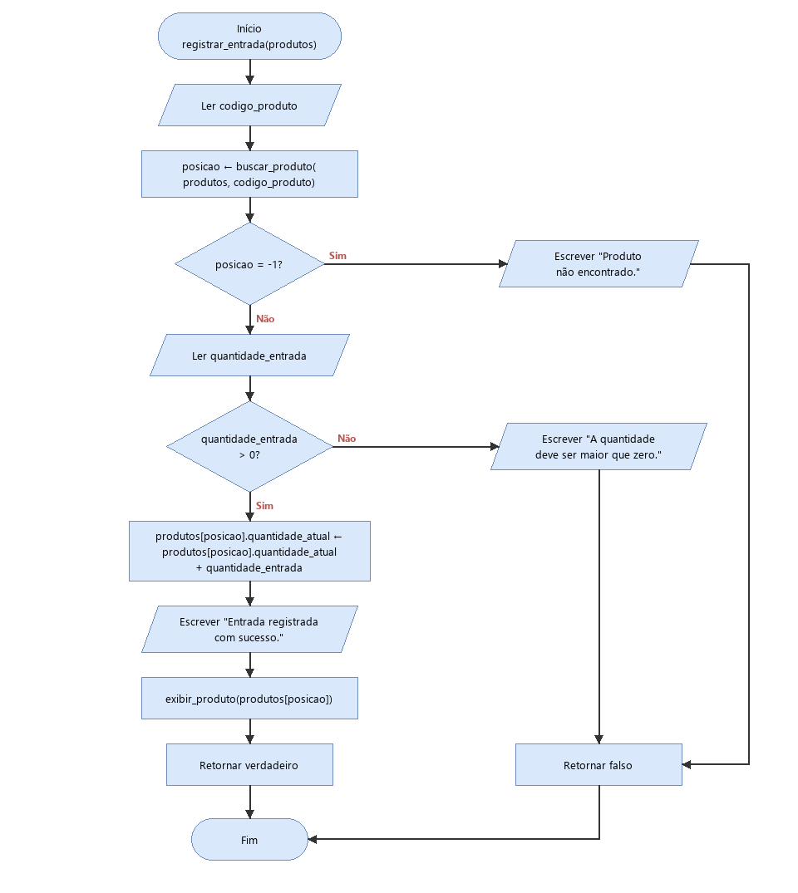
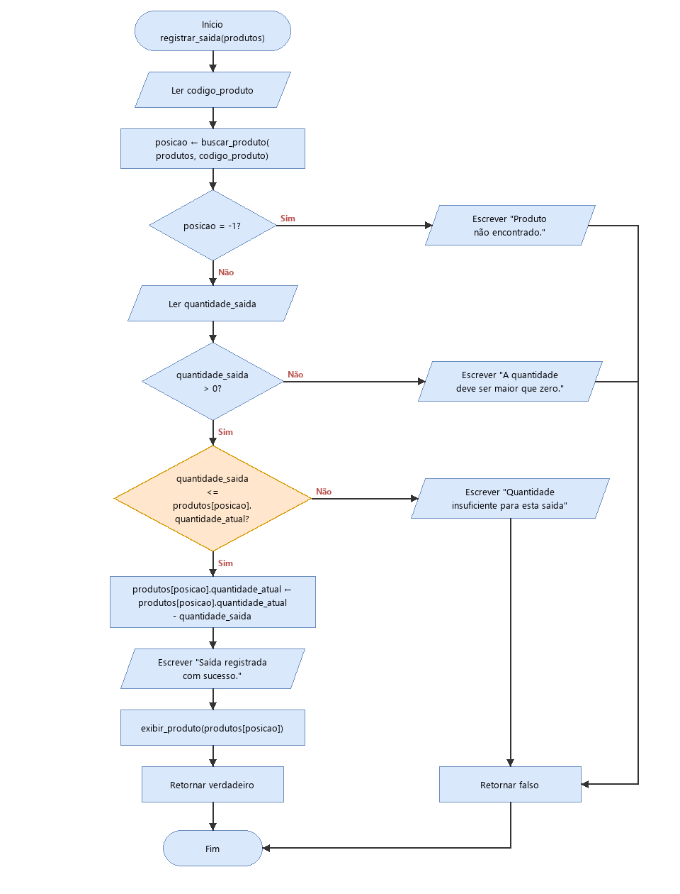

# Entrega 3 - Projeto do Algoritmo (parte de Agnaldo)

## 1. Estratégia utilizada: regras de negócio e validações

O Módulo 2 é o único que altera a `quantidade_atual` de um produto já cadastrado, então é nele que o estoque pode ficar errado. A estratégia é **validar tudo antes de alterar qualquer coisa**: cada função lê os dados, faz as verificações na ordem e só mexe no vetor `produtos` depois que todas passaram. Se uma verificação falhar, a função exibe a mensagem e retorna `falso` na hora, e o menu não chama `salvar_produtos`. Assim nem o vetor nem o CSV ficam com uma movimentação pela metade.

As verificações seguem as regras e restrições da Entrega 2:

| Verificação | Onde | Motivo | Mensagem |
|---|---|---|---|
| `buscar_produto` retorna `-1` | Entrada e saída | Não existe movimentação de produto não cadastrado | "Produto não encontrado." |
| Quantidade `<= 0` | Entrada e saída | Restrição de valores positivos | "A quantidade deve ser maior que zero." |
| `quantidade_saida > quantidade_atual` | Só saída | Condição de Validação de Saída | "Quantidade insuficiente para esta saída" |

Como isso evita estoque negativo e dados inconsistentes:

- **O saldo nunca fica negativo.** O cadastro só aceita `quantidade_atual >= 0`. A entrada só soma valores positivos, então o saldo só cresce. A saída só subtrai quando `quantidade_saida <= quantidade_atual`, então o menor resultado possível é `0`. Partindo de um valor `>= 0` e aplicando só essas duas operações, o saldo continua `>= 0` em qualquer sequência de movimentações.
- **A quantidade precisa ser maior que zero, e não só "não negativa".** Valor negativo é proibido pela restrição da Entrega 2, e também seria uma brecha: uma "entrada de -50" faria uma saída sem passar pela validação de saldo, e uma "saída de -50" faria uma entrada escondida. O valor `0` foi recusado também, porque não muda o estoque e só provocaria uma regravação inútil do CSV.
- **Só quantidades inteiras.** `quantidade_entrada` e `quantidade_saida` são declaradas como `inteiro`, como pede a restrição de tipagem, então a leitura já recusa valores fracionários.
- **A movimentação cai sempre no produto certo.** `buscar_produto` faz busca sequencial pelo `codigo_produto`, que é único (garantido no cadastro). A função devolve a posição do produto no vetor, e a alteração é feita diretamente em `produtos[posicao]`. O valor `-1` indica "não encontrado", como combinado no contrato das funções.
- **O usuário vê o resultado na hora.** Depois de uma movimentação aceita, a função chama `exibir_produto` (Módulo 3), cumprindo o item "exibir a situação atualizada após qualquer transação" da Entrega 2. Se a saída deixou o produto abaixo do mínimo, o alerta "Estoque Baixo / Necessidade de Reposição" já aparece nesse momento.

O tipo de movimentação (entrada ou saída), citado no Módulo 2 da Entrega 2, é escolhido no menu do programa principal (opções 2 e 3). Por isso existem duas funções separadas em vez de uma função que pergunta o tipo.

## 2. Pseudocódigo

### 2.1 Módulo 2: Processamento de Movimentações

```
FUNCAO buscar_produto(produtos, codigo): inteiro
VAR
    i: inteiro

INICIO
    PARA i DE 1 ATE tamanho(produtos) FACA
        SE produtos[i].codigo_produto = codigo ENTAO
            RETORNE i
        FIMSE
    FIMPARA

    RETORNE -1
FIMFUNCAO
```

A busca para assim que encontra o código, porque o código é único e não pode haver outro produto igual mais adiante. Se o laço termina sem encontrar, retorna `-1`. A função só lê o vetor e também é usada pelo cadastro (para checar código repetido) e pela consulta por código.

```
FUNCAO registrar_entrada(produtos): logico
VAR
    codigo_produto: inteiro
    quantidade_entrada: inteiro
    posicao: inteiro

INICIO
    ESCREVA "Codigo do produto: "
    LEIA codigo_produto

    posicao <- buscar_produto(produtos, codigo_produto)
    SE posicao = -1 ENTAO
        ESCREVA "Produto não encontrado."
        RETORNE falso
    FIMSE

    ESCREVA "Quantidade de entrada: "
    LEIA quantidade_entrada
    SE quantidade_entrada <= 0 ENTAO
        ESCREVA "A quantidade deve ser maior que zero."
        RETORNE falso
    FIMSE

    produtos[posicao].quantidade_atual <- produtos[posicao].quantidade_atual + quantidade_entrada

    ESCREVA "Entrada registrada com sucesso."
    exibir_produto(produtos[posicao])
    RETORNE verdadeiro
FIMFUNCAO
```

A soma é a Regra de Entrada da Entrega 2 (`quantidade_atual = quantidade_atual + quantidade_entrada`). Ela só é executada depois das duas validações.

```
FUNCAO registrar_saida(produtos): logico
VAR
    codigo_produto: inteiro
    quantidade_saida: inteiro
    posicao: inteiro

INICIO
    ESCREVA "Codigo do produto: "
    LEIA codigo_produto

    posicao <- buscar_produto(produtos, codigo_produto)
    SE posicao = -1 ENTAO
        ESCREVA "Produto não encontrado."
        RETORNE falso
    FIMSE

    ESCREVA "Quantidade de saida: "
    LEIA quantidade_saida
    SE quantidade_saida <= 0 ENTAO
        ESCREVA "A quantidade deve ser maior que zero."
        RETORNE falso
    FIMSE

    SE quantidade_saida <= produtos[posicao].quantidade_atual ENTAO
        produtos[posicao].quantidade_atual <- produtos[posicao].quantidade_atual - quantidade_saida
        ESCREVA "Saída registrada com sucesso."
        exibir_produto(produtos[posicao])
        RETORNE verdadeiro
    SENAO
        ESCREVA "Quantidade insuficiente para esta saída"
        RETORNE falso
    FIMSE
FIMFUNCAO
```

O bloco `SE ... SENAO` final é a Condição de Validação de Saída escrita do mesmo jeito que na Entrega 2: se `quantidade_saida <= quantidade_atual`, a Regra de Saída (`quantidade_atual = quantidade_atual - quantidade_saida`) é aplicada; senão a operação é bloqueada com a mensagem "Quantidade insuficiente para esta saída". Uma saída igual ao saldo é permitida e deixa o produto com `0`.

## 3. Fluxogramas

### 3.1 Entrada de produtos



### 3.2 Saída de produtos

A decisão `quantidade_saida <= quantidade_atual` está destacada em laranja: é ela que impede o estoque negativo.



Os arquivos `.drawio` com o mesmo nome podem ser abertos no draw.io para editar os fluxogramas.
