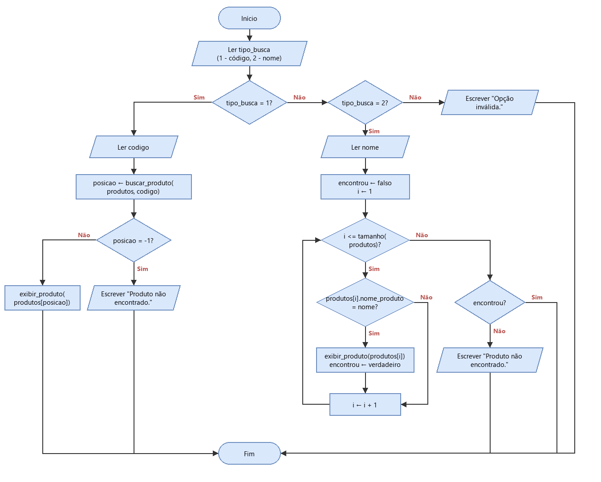
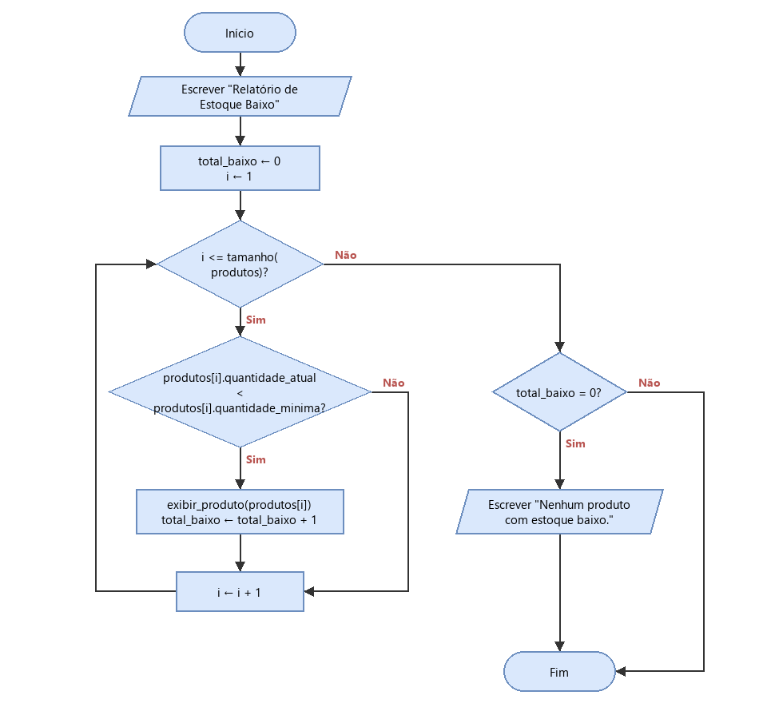

# Entrega 3 - Projeto do Algoritmo (parte de Patrick)

## 1. Estratégia utilizada: visão geral

O problema foi dividido em módulos pequenos, cada um com uma responsabilidade, seguindo a modularização da Entrega 2:

| Módulo | O que faz | Funções |
|---|---|---|
| Programa principal | Mostra o menu e chama o módulo escolhido | `ControleDeEstoque` |
| Módulo 1: Cadastros | Cadastra um produto novo com validações | `cadastrar_produto` |
| Módulo 2: Movimentações | Registra entradas e saídas de estoque | `buscar_produto`, `registrar_entrada`, `registrar_saida` |
| Módulo 3: Consultas | Mostra os produtos na tela | `listar_produtos`, `consultar_produto`, `exibir_produto` |
| Módulo 4: Relatórios | Mostra só os produtos que precisam de reposição | `relatorio_estoque_baixo` |
| Módulo 5: CSV | Lê e grava o arquivo de dados | `carregar_produtos`, `salvar_produtos` |

O fluxo de uso do sistema é sempre o mesmo:

1. Ao abrir, o programa carrega os produtos do CSV para o vetor `produtos`.
2. O menu é exibido e o usuário escolhe uma opção.
3. O programa chama a função do módulo correspondente.
4. Se a opção alterou o estoque (cadastro, entrada ou saída) e deu certo, o CSV é salvo.
5. O menu volta a aparecer até o usuário escolher "Sair".

Os módulos 3 e 4 **só leem** o vetor `produtos`, nunca alteram nada. Por isso eles não retornam valor e o menu não precisa salvar o CSV depois deles.

A função `exibir_produto` é usada por todos os outros: a listagem, a consulta e o relatório chamam ela para mostrar cada produto. Assim a forma de mostrar um produto, e o alerta "Estoque Baixo / Necessidade de Reposição", fica escrita em um lugar só.

## 2. Pseudocódigo

### 2.1 Módulo 3: Consultas e Exibição

```
PROCEDIMENTO exibir_produto(produto)
INICIO
    ESCREVA "Codigo: ", produto.codigo_produto
    ESCREVA "Nome: ", produto.nome_produto
    ESCREVA "Categoria: ", produto.categoria_produto
    ESCREVA "Quantidade atual: ", produto.quantidade_atual
    ESCREVA "Quantidade minima: ", produto.quantidade_minima

    SE produto.quantidade_atual < produto.quantidade_minima ENTAO
        ESCREVA "Status: Estoque Baixo / Necessidade de Reposição"
    SENAO
        ESCREVA "Status: OK"
    FIMSE

    ESCREVA "------------------------------"
FIMPROCEDIMENTO
```

```
PROCEDIMENTO listar_produtos(produtos)
VAR
    i: inteiro

INICIO
    SE tamanho(produtos) = 0 ENTAO
        ESCREVA "Nenhum produto cadastrado."
    SENAO
        ESCREVA "===== LISTA DE PRODUTOS ====="
        PARA i DE 1 ATE tamanho(produtos) FACA
            exibir_produto(produtos[i])
        FIMPARA
    FIMSE
FIMPROCEDIMENTO
```

```
PROCEDIMENTO consultar_produto(produtos)
VAR
    tipo_busca: inteiro
    codigo: inteiro
    nome: cadeia
    posicao: inteiro
    encontrou: logico
    i: inteiro

INICIO
    ESCREVA "Buscar por: 1 - Codigo  2 - Nome"
    LEIA tipo_busca

    SE tipo_busca = 1 ENTAO
        ESCREVA "Codigo do produto: "
        LEIA codigo
        posicao <- buscar_produto(produtos, codigo)
        SE posicao = -1 ENTAO
            ESCREVA "Produto não encontrado."
        SENAO
            exibir_produto(produtos[posicao])
        FIMSE
    SENAO
        SE tipo_busca = 2 ENTAO
            ESCREVA "Nome do produto: "
            LEIA nome
            encontrou <- falso
            PARA i DE 1 ATE tamanho(produtos) FACA
                SE produtos[i].nome_produto = nome ENTAO
                    exibir_produto(produtos[i])
                    encontrou <- verdadeiro
                FIMSE
            FIMPARA
            SE NAO encontrou ENTAO
                ESCREVA "Produto não encontrado."
            FIMSE
        SENAO
            ESCREVA "Opção inválida."
        FIMSE
    FIMSE
FIMPROCEDIMENTO
```

Na busca por código é usada a função `buscar_produto` do Módulo 2, que já devolve a posição ou `-1`. Na busca por nome a lista é percorrida inteira, porque o nome não é único e pode haver mais de um produto com o mesmo nome; todos são exibidos. O nome precisa ser digitado igual ao cadastrado.

### 2.2 Módulo 4: Monitoramento e Relatórios

```
PROCEDIMENTO relatorio_estoque_baixo(produtos)
VAR
    i: inteiro
    total_baixo: inteiro

INICIO
    ESCREVA "Relatório de Estoque Baixo"
    total_baixo <- 0

    PARA i DE 1 ATE tamanho(produtos) FACA
        SE produtos[i].quantidade_atual < produtos[i].quantidade_minima ENTAO
            exibir_produto(produtos[i])
            total_baixo <- total_baixo + 1
        FIMSE
    FIMPARA

    SE total_baixo = 0 ENTAO
        ESCREVA "Nenhum produto com estoque baixo."
    FIMSE
FIMPROCEDIMENTO
```

O relatório usa a mesma condição da Entrega 2 (`quantidade_atual < quantidade_minima`). Como cada produto é mostrado com `exibir_produto`, todos aparecem com o status "Estoque Baixo / Necessidade de Reposição". O contador `total_baixo` serve só para avisar quando nenhum produto precisa de reposição.

## 3. Fluxogramas

### 3.1 Consulta de produto



### 3.2 Relatório de estoque baixo



Os arquivos `.drawio` com o mesmo nome podem ser abertos no draw.io para editar os fluxogramas.
